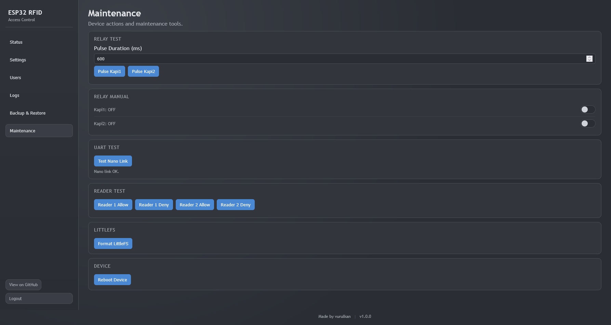
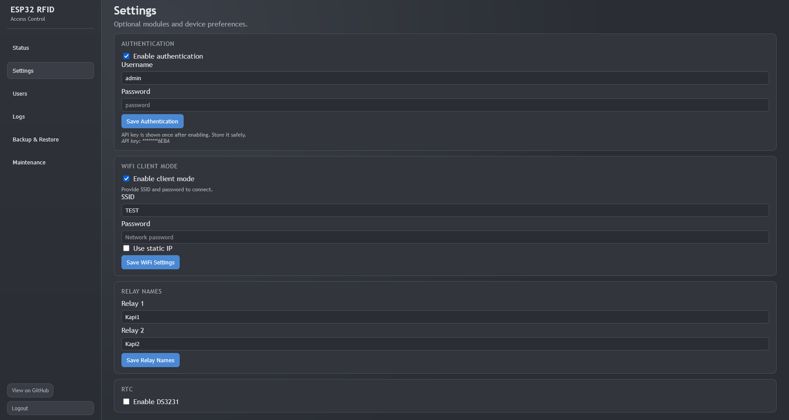
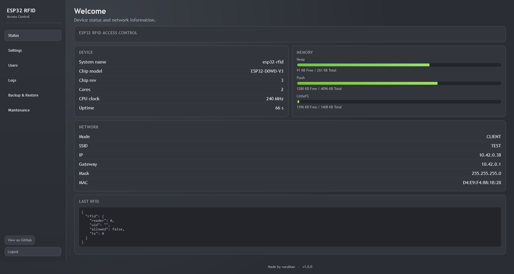
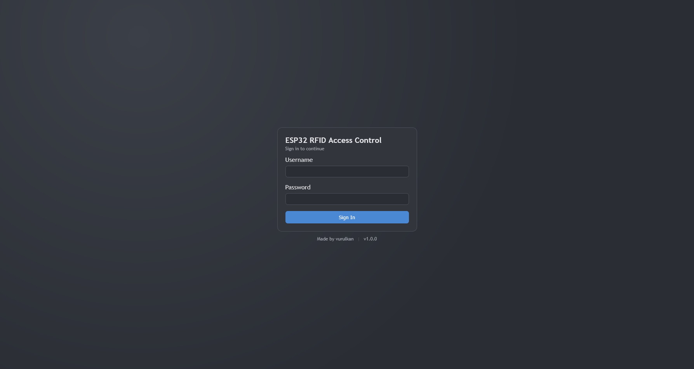
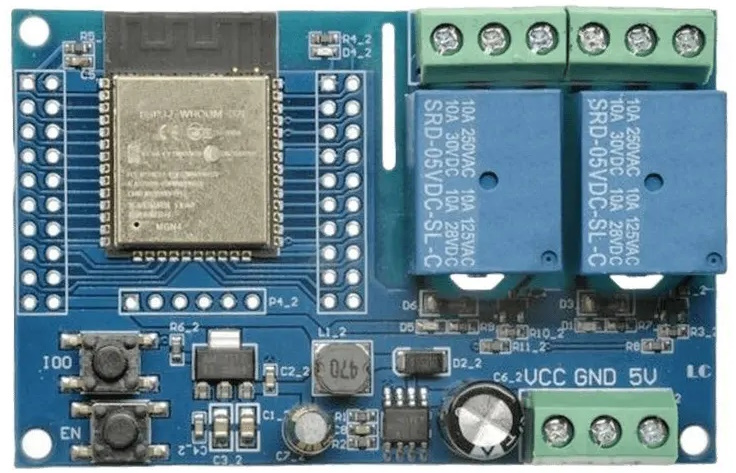
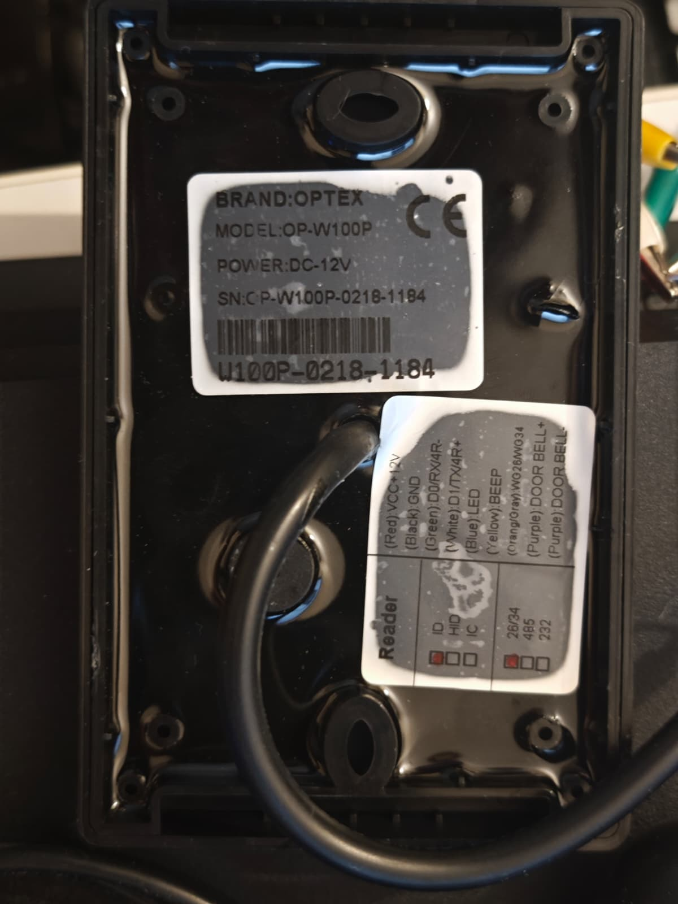
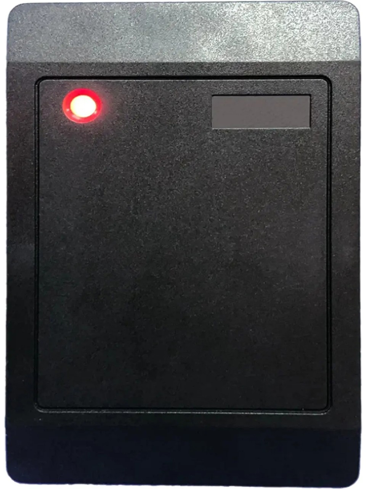

# RFID Access Control (ESP32)

## Screenshots
<p align="center">
  <a href="ss1.png">
    
  </a>
  <a href="ss2.png">
    
  </a>
  <a href="ss3.png">
    
  </a>
  <a href="ss4.png">
    
  </a>
</p>

## Relay Board
<p align="center">
  <a href="board.jpg">
    
  </a>
</p>

## Reader
<p align="center">
  <a href="reader1.jpg">
    
  </a>
  <a href="reader2.jpg">
    
  </a>
</p>

## Overview
- Target: ESP32_Relay X2 Board with ESP32-WROOM-32E (N4)
- Framework: Arduino ESP32 core 2.0.17 (tested); core 3.x is not validated
- Architecture: FreeRTOS tasks + queues, modular components
- Web UI: Embedded gzip assets served via `WebServer`

## Power (ESP32_Relay X2 board)
- Board VCC/GND input accepts DC 5V or 7-30V (board-side terminals, not ESP32 module pins).
- Nano can be powered from the ESP32 board 5V pin.
- Full system can run from a single 12V adapter.

## Requirements
- Arduino IDE with ESP32 core (2.0.17 recommended)
- Optional: DS3231 RTC module
- Arduino Nano (Wiegand bridge, 5V)

## WiFi (AP mode)
- SSID: `RFID-ACCESS`
- Password: `rfid1234`
- Default AP IP: `192.168.4.1`

## WiFi (Client mode)
- Configure SSID/Password in Settings
- Optional static IP (IP/Gateway/Mask)
- IP is shown in Status and printed to Serial after connect

## GPIO / Wiring

### Relay outputs (fixed by board)
- Relay 1: GPIO16
- Relay 2: GPIO17

### Wiegand readers (via Arduino Nano)
| Signal | Nano Pin |
| --- | --- |
| Reader 1 D0 | D2 (interrupt) |
| Reader 1 D1 | D3 (interrupt) |
| Reader 2 D0 | D4 |
| Reader 2 D1 | D5 |
| Reader 1 LED | D6 |
| Reader 1 BEEP | D7 |
| Reader 2 LED | D8 |
| Reader 2 BEEP | D9 |

Nano handles the 5V signals, ESP32 stays at 3.3V.
LED/BEEP lines are active-low (pull to GND to trigger).

### ESP32 <-> Nano UART
- ESP32 RX: GPIO33
- ESP32 TX: GPIO32 (feedback and PING/PONG)
- Nano TX (D1) -> ESP32 RX (GPIO33)
- Nano RX (D0) -> ESP32 TX (GPIO32)
- Common GND is required
- ESP32 default RX/TX pins are not used for this link
- Nano D0/D1 are shared with USB-Serial. Disconnect ESP32 UART when flashing or using Serial Monitor.

### DS3231 RTC (optional, I2C)
- SDA: GPIO21
- SCL: GPIO22
- GND: GND
- VCC: 3.3V or 5V (according to your module)

### IO0 (maintenance)
- Actions are decided **when the button is released** (press duration).
- Hold IO0 for 2-5 seconds to reset WiFi settings (AP mode)
- Hold IO0 for 5-10 seconds to disable authentication
- Hold IO0 for 10+ seconds to format LittleFS and reboot

## Tasks
- `wifi_task`: starts AP/STA, reconnects and opens a recovery AP after 30 seconds without STA.
- `web_task`: REST API + UI.
- `reader_uart_task`: bounded UART reception, framing, feedback and periodic PING.
- `logic_task`: card authorization, relay decisions and the RAM log.
- `users_task`: serialized user persistence and transactional restores.
- `log_writer`: bounded FIFO flash persistence.
- `relay_tick`: priority 4 task, checks pulse deadlines every 5 ms under the relay mutex.
- `maint_task`: physical IO0 recovery actions.

## User Management
- Stored in LittleFS (`/users.txt`), maximum 1000 users.
- Add/delete saves a synchronized temporary file and renames it before publishing the RAM change. A failed save leaves existing permissions intact.
- Restore validates the entire replacement database, including duplicates, capacity, UID, names and permission values, before commit. Restoring fewer users removes the omitted users.
- UID is uppercase hexadecimal, up to 19 characters in storage. The Nano wire protocol accepts exactly 6 or 8 hex characters (26/34-bit Wiegand).
- Names use up to 31 UTF-8 bytes; record delimiters and control characters are rejected rather than truncated.

## Log System
- RAM retains the last 50 entries. JSON replies fit a byte budget, so long entries can reduce the number returned.
- A separate low-priority task persists records through a 32-entry FIFO. Pending records can be lost on sudden power failure. Controlled OTA/reboot/format drains the queue first.
- Recent logs rotate in approximately 16 KiB segments. Retention is limited by 512 KiB, 10,000 recent entries, and a 128 KiB free-space reserve for user/settings transactions. Oldest segments are removed as needed; there is no full-log compaction copy.
- Existing `/logs.txt` becomes `/logs-legacy.txt` on the first upgrade boot. This archive is included in downloads and never automatically pruned. If old history leaves too little space, persistent log errors increase while card authorization continues. Download the history, then explicitly clear all logs if you want to reclaim it.
- Clear-all is queued behind prior writes; success means accepted. `/status` exposes pending writes, errors and drops. Export flushes pending work before streaming.
- CSV columns remain compatible: `<ts_ms>,<relay>,<status>,<uid>,<name>`; a valid RTC adds `<DD/MM/YYYY>,<HH:MM:SS>` after the timestamp.

## Settings (LittleFS)
- Stored in `/settings.txt`; settings snapshots are synchronized and changes are published only after a successful atomic file replacement.
- RTC default is disabled after format or clean install
- RTC validity is checked directly from DS3231 registers on boot and on each read; the legacy `rtc_valid` settings field is retained for backup compatibility and does not override hardware validity.
- WiFi mode and credentials are persisted until format
- Optional static IP for client mode is persisted
- Relay names are persisted (defaults: `Relay 1`, `Relay 2`)
- Relay manual on/off states are persisted
- Relay pulse duration is persisted (default: `600` ms, range: `50-10000` ms)
- Authentication settings are persisted (username, password, API key)

## Backup & Restore
- `GET /backup?type=users|settings|full` returns plain text
- `POST /restore` accepts multipart backups up to 96,000 bytes (recommended for users/full backups); sectioned plain text up to 65,536 bytes remains supported.
- Full restores journal the users/settings pair together; an interrupted commit rolls both files back on next startup. No partial replacement is published in RAM.
- Logs can be downloaded via `/logs/export`

## Build with PlatformIO

```sh
pio run -e esp32dev
pio run -d nano
```

ESP32 uses pinned `espressif32@6.12.0` / Arduino 2.0.17 and the default 4 MB OTA partition table. Web gzip headers are generated automatically and deterministically before compilation. Output: `.pio/build/esp32dev/firmware.bin`.

Relay pulse duration is configurable from Settings or `POST /settings` (`relay_pulse_ms=1000`). Supported range is 50 through 10,000 ms; the API rejects out-of-range values.

## Build & Upload (Arduino IDE)
1. Install ESP32 core (2.0.17 recommended).
2. Open `src/esp32-rfid` as the sketch folder.
3. Board: `ESP32 Dev Module`, select your port.
4. **Tools -> Partition Scheme -> Default 4MB with spiffs** (required for OTA support).
5. Upload and open Serial Monitor at 115200.

## Exporting Firmware Binary (for OTA)

To get a `.bin` file for web-based OTA update:

**Sketch -> Export Compiled Binary** (`Ctrl + Alt + S`)

Arduino IDE compiles and places the output in the sketch's `build/` folder:

```
src/esp32-rfid/
`-- build/
    `-- esp32.esp32.esp32/
        |-- esp32-rfid.ino.bin           <- upload this via web UI
        |-- esp32-rfid.ino.bootloader.bin
        `-- esp32-rfid.ino.partitions.bin
```

Only `esp32-rfid.ino.bin` is needed for OTA. The bootloader and partition files are not required.

## Nano Firmware
- Wiegand bridge firmware is in `nano/wiegand_nano/wiegand_nano.ino`. The updated source adds atomic frame handoff, standard 26/34-bit parity validation and overflow recovery.
- The ESP32 update also works with the previous Nano protocol. Flashing the Nano is optional and requires its USB/serial connection; an ESP32 OTA does not update the Nano.
- UART: 115200 baud, output format `1,UID` or `2,UID` per line.
- Feedback commands from ESP32: `A,<reader>` (allow) or `D,<reader>` (deny).

## First Boot (LittleFS)
- Some new boards may ship with an unformatted LittleFS.
- If you see LittleFS mount errors on first boot, format it via Maintenance -> "Format LittleFS" or hold IO0 for 10+ seconds.

## REST API

Base URL: `http://192.168.4.1` (AP mode default). Replace with your static/DHCP IP in client mode.

When authentication is enabled, add `-H "X-API-Key: YOUR_KEY"` to every request, or use a session cookie obtained from `/auth/login`.

---

### Users

#### List users
Paginated - 50 users per page by default. Pages can be shorter to fit the response byte budget; increment offset by the number of returned users until total is reached.

| Parameter | Default | Description |
| --- | --- | --- |
| `offset` | `0` | Skip N users |
| `limit` | `50` | Results per page (max 100) |

```bash
# First page
curl "http://192.168.4.1/users"

# Second page (e.g. 200 users total)
curl "http://192.168.4.1/users?offset=50&limit=50"

# With API key
curl -H "X-API-Key: YOUR_KEY" "http://192.168.4.1/users?offset=0&limit=50"
```

Response:
```json
{"users":[{"uid":"D7EE4C06","name":"Ali","relay1":true,"relay2":false}],"total":200,"offset":0,"limit":50}
```

#### Add user
```bash
curl -X POST "http://192.168.4.1/users" \
  -d "uid=D7EE4C06&name=Ali&relay1=1&relay2=0"
```

#### Delete user
```bash
curl -X DELETE "http://192.168.4.1/users?uid=D7EE4C06"
```

---

### Logs

#### List recent logs (RAM, last 50)
```bash
curl "http://192.168.4.1/logs"
```

#### Clear RAM logs
```bash
curl -X DELETE "http://192.168.4.1/logs?scope=ram"
```

#### Clear all logs (RAM + LittleFS)
```bash
curl -X DELETE "http://192.168.4.1/logs?scope=all"
```

#### Download full log file
```bash
curl "http://192.168.4.1/logs/export" -o logs.txt
```

---

### RFID

#### Get last scanned card
```bash
curl "http://192.168.4.1/rfid"
```

Response:
```json
{"rfid":{"reader":1,"uid":"D7EE4C06","allowed":true,"ts":12345}}
```

---

### Status
```bash
curl "http://192.168.4.1/status"
```

---

### Settings

#### Get settings
```bash
curl "http://192.168.4.1/settings"
```

Response includes persisted relay pulse duration:
```json
{"relay_pulse_ms":600}
```

#### Set WiFi client mode
```bash
curl -X POST "http://192.168.4.1/settings" \
  -d "wifi_client=1&wifi_ssid=MyNetwork&wifi_pass=MyPassword"
```

#### Set static IP
```bash
curl -X POST "http://192.168.4.1/settings" \
  -d "wifi_static=1&wifi_ip=192.168.1.50&wifi_gateway=192.168.1.1&wifi_mask=255.255.255.0"
```

#### Set relay names
```bash
curl -X POST "http://192.168.4.1/settings" \
  -d "relay1=KapiA&relay2=KapiB"
```

#### Set card-read relay pulse duration
Relay pulse duration is used when an authorized card is read. Values outside `50-10000` ms are rejected.
```bash
curl -X POST "http://192.168.4.1/settings" \
  -d "relay_pulse_ms=1000"
```

#### Enable authentication
```bash
curl -X POST "http://192.168.4.1/settings" \
  -d "auth_enabled=1&auth_user=admin&auth_pass=secret"
```

Response includes `api_key` (shown once - save it):
```json
{"ok":true,"api_key":"3F9A..."}
```

---

### Authentication

#### Login (returns session cookie)
```bash
curl -c cookies.txt -X POST "http://192.168.4.1/auth/login" \
  -d "user=admin&pass=secret"
```

#### Use session cookie for subsequent requests
```bash
curl -b cookies.txt "http://192.168.4.1/users"
```

#### Logout
```bash
curl -b cookies.txt -X POST "http://192.168.4.1/auth/logout"
```

---

### Backup & Restore

#### Download user backup
```bash
curl "http://192.168.4.1/backup?type=users" -o backup-users.txt
```

#### Download settings backup
```bash
curl "http://192.168.4.1/backup?type=settings" -o backup-settings.txt
```

#### Download full backup (users + settings)
```bash
curl "http://192.168.4.1/backup?type=full" -o backup-full.txt
```

#### Restore from backup file
```bash
curl -X POST "http://192.168.4.1/restore" \
  -F "file=@backup-full.txt"
```

---

### RTC

#### Read current RTC time
```bash
curl "http://192.168.4.1/rtc"
```

#### Set RTC time
```bash
curl -X POST "http://192.168.4.1/rtc" \
  -d "datetime=2025-05-10T14:30:00"
```

---

### Maintenance

#### Pulse relay (momentary activation)
```bash
# Relay 1, configured default duration (600 ms on clean install)
curl -X POST "http://192.168.4.1/maintenance/relay" \
  -d "relay=1&action=pulse"

# Relay 2, custom one-time duration
curl -X POST "http://192.168.4.1/maintenance/relay" \
  -d "relay=2&action=pulse&duration_ms=1000"
```

#### Set relay state (manual on/off)
```bash
curl -X POST "http://192.168.4.1/maintenance/relay" \
  -d "relay=1&action=on"

curl -X POST "http://192.168.4.1/maintenance/relay" \
  -d "relay=1&action=off"
```

#### UART link test (ESP32 <-> Nano ping)
```bash
curl -X POST "http://192.168.4.1/maintenance/uart-test"
```

#### Reader feedback test (LED + beep)
```bash
# Allow signal on reader 1
curl -X POST "http://192.168.4.1/maintenance/reader-test" \
  -d "reader=1&action=allow"

# Deny signal on reader 2
curl -X POST "http://192.168.4.1/maintenance/reader-test" \
  -d "reader=2&action=deny"
```

#### Format LittleFS (erases all data)
```bash
curl -X POST "http://192.168.4.1/maintenance/format"
```

#### Reboot device
```bash
curl -X POST "http://192.168.4.1/maintenance/reboot"
```

---

### Firmware Update (OTA)

Upload a new firmware binary. Device reboots automatically after a successful update.

> **Requires OTA-compatible partition scheme** (e.g. Default 4MB with SPIFFS/LittleFS).
> Select via Arduino IDE: **Tools -> Partition Scheme -> Default 4MB with spiffs**.

```bash
curl -X POST "http://192.168.4.1/firmware" \
  -H "X-API-Key: YOUR_KEY" \
  -F "firmware=@esp32-rfid.ino.bin"
```

Response on success (device reboots immediately after):
```json
{"ok":true}
```

## Maintenance Tests
- Reader test (allow/deny) triggers LED/BEEP feedback for each reader.

## Authentication
- When enabled, the UI shows a login page.
- API requests accept `X-API-Key` or an authenticated session cookie.
- API key is shown **once** when enabling; store it safely.
- Session has a 5-minute inactivity timeout and can be ended via Logout.
- Logout is explicit; browsers cannot reliably distinguish refresh vs close.

## Notes
- Maintenance tasks can be done via UI or IO0 button (2-5s WiFi reset, 5-10s auth disable, 10s+ format).

### Regenerate Web Assets
- If you edit `src/esp32-rfid/web/*`, regenerate `*.gz.h` assets. Run `pack_web.py` from `src/esp32-rfid/web/`:
```
python pack_web.py
```

## UART Protocol (Nano -> ESP32)
- One line per card read, terminated by `\\n`
- Format: `1,UID` or `2,UID`
- `UID` should be uppercase hex without spaces (e.g., `D7EE4C06`)

## UART Protocol (ESP32 -> Nano)
- Automatic card handling sends no additional success beep: readers keep their own card-read sound. Denied access still sends `D,<reader>`. The manual reader test can explicitly send `A,<reader>`.
- `A,1` or `A,2` -> access granted (LED + beep)
- `D,1` or `D,2` -> access denied (double beep)
- `PING` -> Nano replies with `PONG`

## Reliability diagnostics and data-preserving updates

- `/status` and the UI diagnostics show UART reception/errors/invalid frames, queue drops, feedback drops, periodic PONG time, log errors/drops/pending writes, logic heartbeat, maximum queue delay, expired cards, startup readiness, relay GPIO state, reset reason and minimum/largest heap. Counters reset on reboot. GPIO state is the ESP32 output level, not physical confirmation that the lock opened.
- Queue-set membership is configured while queues are empty, before any producers start. Readers/web wait for application initialization. Initialization failures are reported instead of silently reducing user capacity.
- Card authorization drives the relay before RTC reads and log preparation. User saves and flash logs run in separate tasks. Card events aged 2 seconds or more and expired relay requests are discarded.
- HTTP request IDs and separate persistent reply queues reject stale/cross-worker replies. The UI checks HTTP/application failures, bounds fetch time, and prevents overlapping polls or polling during uploads.
- OTA accepts exactly one firmware file. It finalizes only after the full HTTP request is accepted and maintenance preparation succeeds. Failed/aborted requests do not trigger reboot or release someone else's maintenance state.
- Upload only the application `.bin` through the existing Firmware Update page. The update preserves the existing filesystem and partition table. Keep a users/settings backup; do not select format, erase flash, upload filesystem, or upload bootloader/partition binaries for this update.
- The build default describes this binary's supported board/layout; it does not inspect a deployed board. This binary fits the default 1,310,720-byte app slot. Other deployed layouts need their own capacity check.
- Authentication requires complete valid credentials. Password/configuration changes invalidate old sessions. Sessions expire after 5 minutes of inactivity using a 64-bit clock; the API key remains an independent credential.
- Partial settings updates preserve omitted fields. `wifi_pass_clear=1` explicitly clears a saved WiFi password; all persisted network changes report the need to reboot.
- See [the completed repair report](docs/duzeltmeler-2026-11-20.md) for the finding-by-finding changes, exact test evidence and hardware limits.

## DS3231 RTC reliability

- Startup/toggling never sets a default date or overwrites the battery-backed time. The legacy `rtc_valid` flash value cannot override the live hardware checks.
- Reads validate OSF, EOSC, BCD, calendar ranges and 12/24-hour registers. Supported dates are 2000 through 2099. Startup enables battery-backed oscillation while preserving the time and oscillator-loss evidence.
- Explicit adjustment clears OSF only after writing the requested time. Readback must match within one second. A persistent adjustment marker makes an interrupted write visible after reboot until the time is set successfully again.
- RTC access shares a mutex with a 50 ms lock wait and 50 ms I2C timeout. Temporary bus failures are retried on future reads. Relay activation precedes RTC access.
- States: `disabled`, `unavailable`, `busy`, `lost_power`, `invalid_datetime`, `oscillator_disabled`, `adjustment_pending`, `ready`. `lost_power` describes the oscillator-stop flag, not a measured battery voltage.
- An old uncleared OSF may require setting the date/time once after upgrade. Firmware cannot restore a failed battery or repair wiring/noise.

## Validation

Host tests use production C++ services/callbacks with simulated RTOS/GPIO/I2C/HTTP, POSIX temporary files and address/undefined-behavior sanitizers. Requirements: Linux/WSL, g++, Python 3; Node.js for UI tests.

```sh
python3 -m unittest discover -s tests -p 'test_*.py' -v
node --test tests/web.test.cjs
```

After OTA on the actual installation, verify users/settings, both readers under web/log activity, relay pulse duration, and RTC time retention across a main-power interruption. The host tests and successful builds do not establish the physical cause of the intermittent fault, battery health, real flash power-loss behavior or FreeRTOS latency under electrical interference.
